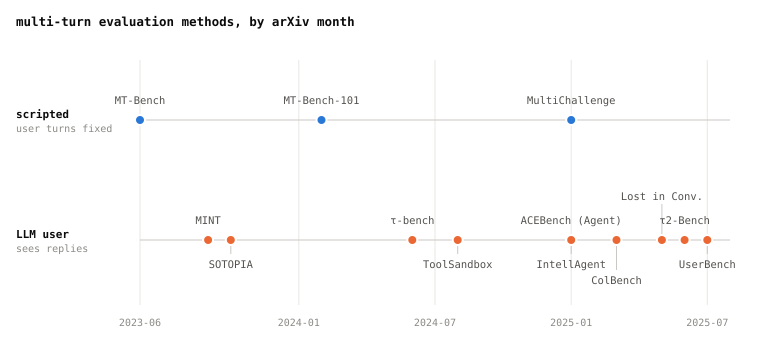

# Multi-turn Agent Eval 2 - From Scripted Conversations to LLM Users

In post 1 we split multi-turn evaluation in two: whether the user's next line is
**written in advance**, or **written by an LLM after reading the agent's answer**.
Here are thirteen methods published since 2023, grouped into those two types and listed
by date.



**Only three methods use scripted conversations. From 2024 on, most methods use an LLM
user.** As using an LLM to play the user became common, the field moved toward measuring
how well an agent actually sends and receives messages.

## 1. One line each

```
  Posted    Name            User lines   Who writes the next turn         What is graded
  2023-06   MT-Bench        scripted     a scripted 2nd-turn question     GPT-4 scores 1-10 ·
                                                                          compares two answers
  2023-09   MINT            LLM          a user GPT-4 plays, giving       success within the allowed
                                         feedback                         number of turns
  2023-10   SOTOPIA         LLM          role-play partner (agent ·       7 things, graded by
                                         human)                           humans and GPT-4
  2024-02   MT-Bench-101    scripted     a history filled with correct    GPT-4 grades each turn; uses the lowest score
                                         answers written in advance
  2024-06   τ-bench         LLM          LLM user                         final state · pass^k
  2024-08   ToolSandbox     LLM          LLM user                         steps along the way and
                                                                          final state
  2025-01   ACEBench        both         gpt-4o user                      final state + how tools
                                                                          were called
  2025-01   MultiChallenge  scripted     a scripted history               a yes / no question for
                                                                          each problem
  2025-01   IntellAgent     LLM          a user agent built from policy   whether policy was followed
  2025-03   ColBench        LLM          LLM partner                      unit test · how closely the
                                                                          pages match
  2025-05   Lost in Conv.   LLM          a user giving one piece at a     compared with the same task's
                                         time                             single-turn score
  2025-06   τ2-Bench        LLM          LLM user (uses tools too)        5 kinds including final state ·
                                                                          pass^k
  2025-07   UserBench       LLM          a user who shows what they want  whether the answer matches
                                         without saying it directly       everything the user wanted
```

ACEBench differs by group. The fixed tasks (Normal) use scripted conversations. Only
the Agent tasks use an LLM user. The timeline uses the Agent tasks to place ACEBench.

## 2. Scripted conversations differ in how many times the agent answers

```
  MT-Bench        Answers both turn 1 and turn 2. The turn 2 question is the same no
                  matter what the turn 1 answer was
  MT-Bench-101    Answers every turn, but earlier turns are filled with correct
                  answers written in advance (golden context)
  MultiChallenge  Earlier turns were written by another model and edited by humans.
                  Answers only the last turn
```

MT-Bench-101 explained why. If a model makes a mistake early, the rest of the
conversation becomes awkward, and the comparison is then no longer fair. But this way
it cannot test **whether a model can fix its own mistakes and continue the conversation**. Post 3 looks at
MultiChallenge in detail.

## 3. LLM users differ in how they play the user

**Checking whether the agent finishes the task.** τ-bench, ToolSandbox, ACEBench and τ2-Bench
have the agent change bookings and fix settings with tools, and look at **the state
after the conversation ends**. ToolSandbox looks not only at the end but also at steps the agent must
complete (milestone) and actions it must avoid (minefield). Post 4 looks at
τ2-Bench in detail.

IntellAgent looks at **policy** instead of the final state. It automatically creates
test situations from a company's policy document. After the conversation, a judge LLM
reads it and writes down which policies were tested and which were broken. It
can be used in domains with no public benchmark.

**Checking whether it finds things out through conversation.** The user does not say
everything from the start.

```
  MINT            When the answer is wrong, GPT-4 gives only a hint, like a teacher
  Lost in Conv.   Splits the task into pieces and gives one in each turn
  UserBench       Starts with a goal that is not clear and shows what they want without
                  saying it directly
```

Lost in Conversation uses the clearest method. It compares giving **the same task** all
at once with giving it in pieces over several turns. This directly shows how much the
score drops because of the extra turns. Recent models dropped **39% on average.** In the paper's words,
*"when LLMs take a wrong turn in a conversation, they get lost and do not recover"*.

UserBench wrote that on average only **20%** of answers matched everything the user wanted.
Even the best model found out less than 30% of the user's preferences (what the user
likes or wants).

**Building things or talking with others.** In ColBench the agent sends messages to and
receives messages from a partner played by an LLM. Together they build backend code
(graded with unit tests) and web pages (graded by how closely their images match the
reference page). SOTOPIA runs role-plays with social goals, and humans and GPT-4 grade
7 things, including whether the goal was reached.

## 4. The three Kimi K2 picked

Kimi K2 (July 2025) measured multi-turn ability with these three.

```
  τ2-Bench        2025-06   LLM user                does it finish the job with tools     66.1
  ACEBench        2025-01   both                    does it call tools correctly          76.5
  MultiChallenge  2025-01   scripted conversation   does it remember the details of a     54.1
                                                    long conversation
```

Two methods use LLM users, and one uses scripted conversations. But ACEBench's 76.5 is
*"overall on ACEBench English"*. It combines all three groups, not just the Agent
tasks, so it does not measure only multi-turn tasks.

## Sources

- Dates are the month a paper first appeared on arXiv. The descriptions come from each
  paper's summary and main text. The numbers come from the main text.
- **Zheng and others 2023** · *Judging LLM-as-a-Judge with MT-Bench and Chatbot Arena*.
  [`arXiv:2306.05685`](https://arxiv.org/abs/2306.05685).
- **Wang and others 2023** · *MINT*. [`arXiv:2309.10691`](https://arxiv.org/abs/2309.10691).
- **Zhou and others 2023** · *SOTOPIA*. [`arXiv:2310.11667`](https://arxiv.org/abs/2310.11667).
- **Bai and others 2024** · *MT-Bench-101*. [`arXiv:2402.14762`](https://arxiv.org/abs/2402.14762).
- **Yao and others 2024** · *τ-bench*. [`arXiv:2406.12045`](https://arxiv.org/abs/2406.12045).
- **Lu and others 2024** · *ToolSandbox*. [`arXiv:2408.04682`](https://arxiv.org/abs/2408.04682).
- **Chen and others 2025** · *ACEBench*. [`arXiv:2501.12851`](https://arxiv.org/abs/2501.12851).
- **Sirdeshmukh and others 2025** · *MultiChallenge*.
  [`arXiv:2501.17399`](https://arxiv.org/abs/2501.17399).
- **Levi · Kadar 2025** · *IntellAgent*.
  [`arXiv:2501.11067`](https://arxiv.org/abs/2501.11067). Section 3.3, Dialog Critique,
  explains policy judging.
- **Zhou and others 2025** · *SWEET-RL* (ColBench). [`arXiv:2503.15478`](https://arxiv.org/abs/2503.15478).
- **Laban and others 2025** · *LLMs Get Lost In Multi-Turn Conversation*.
  [`arXiv:2505.06120`](https://arxiv.org/abs/2505.06120).
- **Barres and others 2025** · *τ2-Bench*. [`arXiv:2506.07982`](https://arxiv.org/abs/2506.07982).
- **Qian and others 2025** · *UserBench*. [`arXiv:2507.22034`](https://arxiv.org/abs/2507.22034).
- **Kimi Team 2025** · *Kimi K2*. [`arXiv:2507.20534`](https://arxiv.org/abs/2507.20534).
  Scores are from Table 3. The evaluation section says the ACEBench score covers all
  three groups.
