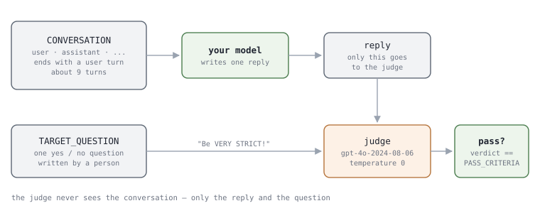
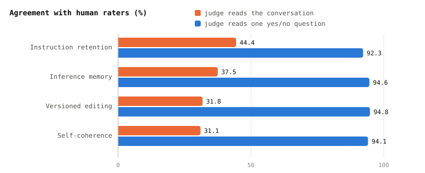
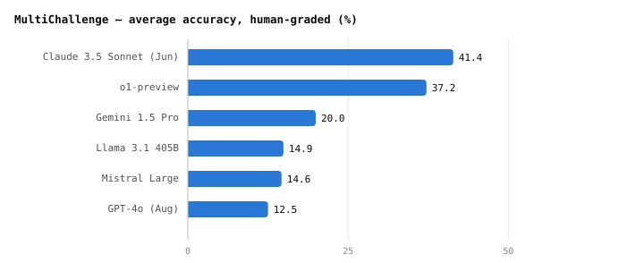

# Multi-turn Agent Eval 3 - MultiChallenge Fixes the Conversation and Grades One Answer

**This paper was made to automatically grade how well a model talks with a person
over many turns. It uses problems that even the latest models get wrong.**

Scale AI released it in January 2025. The paper says that the latest models score
almost perfectly on existing multi-turn benchmarks. So it collected only
conversations those models actually fail, and all scores were below 50%.

## 1. It asks about four things

```
  Category                    Items   What it checks
  Instruction retention       69      Does it follow the instruction from the first turn until the end
  Inference memory            113     Does it use details the user mentioned earlier, without being reminded
  Reliable versioned editing  41      After many edits, does it keep editing the right version
  Self-coherence              50      Does it drop an earlier correct answer when the user doubts it
```

The last row checks whether the model agrees with the user just to please them
(sycophancy). When the user asks the same thing again or sounds a little
unsure, the model drops its earlier correct answer and agrees with the user.
The paper says this makes conversations awkward and lowers trust.

## 2. One problem looks like this

Each line of the released file `benchmark_questions.jsonl` is one problem. Here is
one Inference memory problem.

```
  AXIS            INFERENCE_MEMORY
  CONVERSATION
    user        "... I prefer venues that are within a 5-minute walk from the
                 UN headquarters."
    assistant   "... Here are a few suggestions that are within a 5-minute walk:
                 ..."
    user        "I am meeting a German diplomat on Friday. I am looking for a
                 suitable place to have lunch with him, preferably an up-class
                 restaurant. ..."
  TARGET_QUESTION "Are the restaurants chosen within a 5-minute walk from the
                   UN headquarters?"
  PASS_CRITERIA   "YES"
```

The conversation **ends on a user turn.** The model writes a single answer to that
last turn. The last turn does not repeat the "5-minute walk". The model has to
remember and use the information from the first turn without being reminded.

```
  CONVERSATION      the user and assistant take turns. 9.1 turns on average (3-19)
  TARGET_QUESTION   a yes / no question you can answer by reading only the model's answer. Written by people
  PASS_CRITERIA     the answer needed to pass. "YES" for all 273
```

**It reads many turns and writes one.** This is the "scripted conversation" from
post 1. Looking at the last turn alone, any fancy restaurant could be a correct answer.
The answer is only right if it uses the first turn, and that is what makes it a
multi-turn test. So this test cannot show whether a model can fix its own earlier
mistake. But every model starts from the same history, so we can compare them
under the same conditions.

## 3. The problems were made like this


**This figure shows how the test problems are made.** You do not run it
when measuring your agent; you only use the files it produced. The figure in
section 4 shows how grading works.

Three LLM agents create the conversation. The paper calls this setup MMSE.

```
  Planner      takes a topic, a description of a person and a category definition, and
               writes a plan (blueprint) for the conversation. Changes the plan as the
               conversation continues and checks whether the answering model made a mistake
  User agent   turns the plan into real user lines. Tries to make the answering model make a mistake
  Responder    the answering side. One of the 6 latest models, picked at random for each problem
```

If the Planner finds a failure it stops and saves; if it finds none within the
turn limit, the conversation is dropped. People edit each saved conversation.
They check that it fits the category, that it reads naturally, and that **at
least 3 of the 6 latest models fail it**. Then people who did not make the first
edits review it in two more stages.

Because an LLM wrote the first version, people had less work to do. Writing a
whole new problem took 154.4 minutes; editing one took 73.6 minutes. The text
before and after editing was 74.5% alike on average, measured by Levenshtein
distance (a way to count text changes), and the authors took the remaining 25.5%
as the part people edited.

## 4. Grading uses one question



**The judge model does not see the conversation.** It gets only the model's
answer and a yes / no question. Here is the full judge prompt, exactly as
written in the authors' code.

```
  You are tasked with evaluating a model response to see if it meets a specific criteria.
  The criteria will always be YES/NO evaluation.
  The model response is as follows:
  <MODEL_RESPONSE>
  {}
  </MODEL_RESPONSE>
  The criteria that the model response must meet is as follows. Be VERY STRICT!:
  <CRITERIA>
  {}
  </CRITERIA>
  Print your reasoning followed by your verdict, either "YES" or "NO".
```

The model's answer goes in the first `{}` position, and `TARGET_QUESTION` goes
in the second (I removed the blank lines). `gpt-4o-2024-08-06` judges at
temperature 0, and the answer passes if the judge's result matches `PASS_CRITERIA`.

**Why not show the conversation?** Given the whole conversation and the rules for
passing or failing in that category, the judge agreed with people 37.33% of the
time.
Given one question, it agreed 93.95% of the time. The paper explains it this way.
The judge models themselves cannot score above 50% on this test, so
it is hard to trust them to read the conversation and judge someone else's answer
correctly. With only one question, the judge only has to check simple things,
such as **is there a nut in the answer, is the restaurant 5 minutes away**.



The overall score is a **simple average** of the four category scores. The
category with 41 problems and the category with 113 problems count equally.

## 5. There is code

[ekwinox117/multi-challenge](https://github.com/ekwinox117/multi-challenge),
linked directly from the paper, has the data for all 273 problems, the grading
code, and answers from the 12 models tested in the paper. Here is how to use it.

```
  If you already have answers   python main.py --responses-file my_responses.jsonl --output-file results.txt
  To ask a model directly       python main.py --model-provider openai --provider-args model=gpt-4o temp=0 ...
```

Judging needs an OpenAI API key. If you run several times, as with `--attempts 3`,
it counts as a pass **if any one attempt passes**. This is pass@k, the
opposite of pass^k in post 1.

With the code at commit `5ccefcc`, grading probably will not start. `src/evaluator.py`
passes `max_tokens=4096`, but the constructor in `src/models/openai.py` does not
accept that argument. This is what I think after reading the code; I did not run it.

## 6. What the paper found

These are the results graded directly by people (Table 2). Each is the average of
the four categories.



Here is what the paper found.

```
  1  All of the latest models are under 50%. First place is 41.4%
  2  Each model is best at a different category. Claude is highest on retention (58.6),
     o1-preview on memory (41.5) and editing (39.0)
  3  Scores show no clear pattern as the number of turns grows. The authors think the hard
     part may be reasoning that uses earlier turns, rather than the conversation's length
  4  Judging with a single question agrees with people 93.95% of the time. Automatic
     grading can be trusted
```

The paper also lists its own limits. First, **the test is harder for the 6
models used to select the problems.** Only problems those models failed were
kept. Even so, the models that are publicly available and were tested later all
scored below Claude 3.5 Sonnet and o1-preview. Second, **problems that were hard to judge even with a
yes / no question were left out.** The authors wrote that they will release them
when they can grade them.

Later models scored higher. As we saw in post 2, Kimi K2 (July 2025) scores 54.1.

## 7. To evaluate your agent

```
  For each of the 273 problems
    1  give CONVERSATION to the agent as the conversation history. The last turn is a user turn
    2  your agent writes one answer
    3  collect {"QUESTION_ID": ..., "RESPONSE": ["answer"]}, one per line
  grade with python main.py --responses-file my_responses.jsonl --output-file results.txt
```

Things to decide before giving the history to the agent.

- **How to give the agent the conversation history.** This test gives the
  earlier turns as **the history of the current conversation**. It does not test
  whether the agent can remember a past session. Even if your agent has a long-term memory system,
  putting the history directly into the context matches what the test is meant
  to measure.
- **The earlier assistant answers are not yours.** They were written by another
  model (one of the 6 latest models). Leave them as they are, even if they do
  not sound like your agent.
- **Run it once.** If you increase `--attempts`, the task passes when any one
  attempt passes, so the score rises. To compare with the paper's numbers, keep it at 1.

Post 6 suggests how to build a test like this from your own data.

## Sources

- **Sirdeshmukh and others 2025** (Scale AI) · *MultiChallenge: A Realistic Multi-Turn
  Conversation Evaluation Benchmark Challenging to Frontier LLMs*.
  [`arXiv:2501.17399`](https://arxiv.org/abs/2501.17399) (January 2025).
- **The table and the text differ in one place.** The text of section 5.1 gives
  Claude 3.5 Sonnet 38.3%, o1-preview 34.6 and Gemini 19.1, but Table 2 right
  above it and the paper's summary give 41.42 · 37.23 · 19.96. v1 (January 2025) and v2
  (March 2025) are the same. The chart follows the table.
- **The data and grading in sections 2 · 4 · 5 · 7 were checked in the authors'
  repository.** They are `data/benchmark_questions.jsonl`, `src/evaluator.py`,
  `src/result_parser.py` and `main.py` in
  [ekwinox117/multi-challenge](https://github.com/ekwinox117/multi-challenge), as
  of commit `5ccefcc` from February 5, 2025.
- **Kimi K2 describes it differently.** The K2 report introduces this test in one
  line as *"multi-turn dialogues with conflicting instructions"*, but the original
  paper's instruction retention actually says *"human users don't provide followup
  instructions that contradict the first-turn instructions"*.
- **The license is the arXiv default, so the paper's figures are not included.**
  The figures in sections 3 · 4 are drawn by `scripts/gen_multichallenge_graphs.py`,
  and the charts in sections 4 · 6 by `scripts/gen_multiturn_charts.py` from the
  numbers in Table 4 and Table 2.
