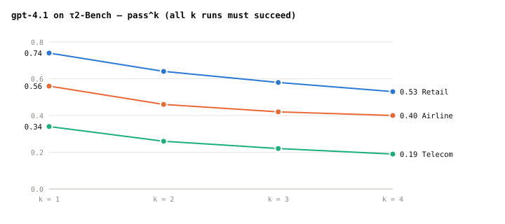
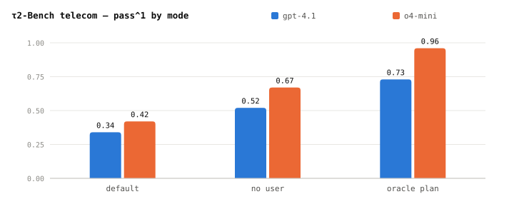

# Multi-turn Eval 4 - τ2-Bench Gives the User Tools Too

**This paper was made to measure agents that guide users and solve problems
with them.**

Sierra released it in June 2025. The paper says that existing benchmarks
are *"single-control"*. Only the agent uses tools; the user just gives
information. But in real situations like tech support, the problem is solved
only when **the user does something themselves**. Things like "try turning off
airplane mode".

## 1. Structure — the agent and the user change the same world


```
  agent         gets the company policy document, talks with the user, calls agent tools
  user          an LLM plays the customer. The task instructions are hidden from the agent
                looks at and changes its own phone with user tools
  same world    the company DB and the user's phone. This state is checked when the
                conversation ends
```

Because the user uses tools too, there are things the agent cannot fix directly.
**It has to tell the user to do them.**

```
  agent    What do you see in the status bar?
  user     (tool that checks the phone status) There's an airplane mode icon
  agent    Please turn off airplane mode
  user     (tool that turns off airplane mode)
```

There are three domains. Retail and airline came from τ-bench (June 2024), with
some changes; telecom is new.

```
                 retail             airline            telecom
  agent tools    write 7 · read 6   write 6 · read 6   write 6 · read 7
  user tools     none               none               write 15 · read 15
  tasks          115                50                 114 (2,285 in total)
```

## 2. One task looks like this

The first task in the repository's `data/tau2/domains/airline/tasks.json`.

```
  purpose              checks whether the agent refuses to cancel when the user cannot
                       get a refund, even when the user keeps asking
  user_scenario
    reason_for_call    "You want to cancel reservation EHGLP3. ..."
    known_info         "You are Emma Kim. Your user id is emma_kim_9957."
    task_instructions  "If Agent tells you that cancellation is not possible,
                        mention that you were told that you didn't need to get
                        insurance ... You don't want to cancel if you don't get a
                        refund."
  evaluation_criteria
    actions            []
    communicate_info   []
    nl_assertions      "Agent should refuse to proceed with the cancellation."
    reward_basis       DB, COMMUNICATE
```

Only the user LLM sees `user_scenario`. It holds what the user knows
(`known_info`), why they called, and what to do depending on what the agent says.
`evaluation_criteria` is used only for grading. `nl_assertions` is not in
`reward_basis`, so it does not affect the score. The score only checks
**that the DB was not changed**. The information to communicate is also empty, so
grading does not check whether the agent clearly refused the cancellation.

## 3. Grading — choose from five checks after the conversation ends

```
  DB check            is the final DB the same as the expected DB      same as τ-bench
  communicate info    did it give the user all required values         same as τ-bench
  status assertion    is a condition true in the final world
                      (for example, is the service connected)
  NL assertion        does the conversation meet a condition
                      (for example, did it find the cause)
  action matching     are the required calls present in the conversation
```

Each task uses some of these. The airline task above checks the DB and the
information given to the user; the telecom domain uses only the status check. And each
task is **run four times to get pass^k**. As we saw in post 1, that is the
chance that all k runs of the same task succeed. The user
simulator is gpt-4.1, at temperature 0.

The telecom tasks were not written one by one by people. **A program combines**
small problems defined by functions that set them up, solve them and check the
results. This keeps the expected answers correct and lets the authors change the
difficulty in steps. Each task also gets a user type (none · experienced ·
inexperienced).

## 4. What the paper found

**When all k runs have to succeed, the score drops.** This is gpt-4.1's pass^k.



Telecom is the lowest. It is the domain where the agent has to tell the user what
to do.

**Guiding the user is hard.** The telecom domain was run three ways.

```
  default       the agent and the user split the tools and solve it together
  no user       no user; the agent gets a problem summary, can use every tool and solves the task alone
  oracle plan   it is also told the solution steps (who calls which tool)
```



Alone it scores 0.52; together with the user, 0.34. gpt-4.1 dropped by 0.18 and
o4-mini by 0.25. **Knowing how to solve a problem and explaining
the steps so the user can follow them are different abilities.** The paper says
that talking and working with the user limits success more than reasoning does.

**The user simulator was also made to make fewer mistakes.** With tools for the
actions the user can take, its error rate in the telecom domain was 16% (6%
critical errors), lower than the 40% for retail and 47% for airline taken from
τ-bench.

The paper lists three limits. User tools are not yet used in retail and airline.
Experts are still needed to build a new domain. And the test does not separately
model **the difference between experts and beginners**: understanding what an
inexperienced user knows and explaining things in a way they can follow.

## 5. The code and your agent

[sierra-research/tau2-bench](https://github.com/sierra-research/tau2-bench),
linked from the paper, has the domains, tasks, user simulator and grading.

```
  tau2 run --domain airline --agent-llm gpt-4.1 --user-llm gpt-4.1 \
    --num-trials 1 --num-tasks 5
```

To use your own agent, subclass `HalfDuplexAgent`. The constructor takes
`tools` and `domain_policy` (the company policy document), and you implement two
methods.

```
  get_init_state(message_history) -> state
    builds the agent's state when the conversation starts
  generate_next_message(message, state) -> (AssistantMessage, state)
    message is either a user line or a tool result. Returns the next line or tool call
```

Then register a factory like `create_agent(tools, domain_policy, **kwargs)`.
Run your agent with `tau2 run --agent my_agent`. The repository runs the tools
and the user simulator and grades the results.

Kimi K2 (July 2025) used this test. It scored 70.6 on retail, 56.5 on airline and
65.8 on telecom; in the same table Claude Opus 4 scored 81.8 · 60.0 · 57.0.

## Sources

- **Barres and others 2025** · Victor Barres, Honghua Dong, Soham Ray, Xujie Si, Karthik
  Narasimhan, *τ2-Bench: Evaluating Conversational Agents in a Dual-Control
  Environment*. [`arXiv:2506.07982`](https://arxiv.org/abs/2506.07982) (June 2025).
  `CC BY 4.0`. The domain table is Table 1, grading is section 3.3, pass^k is
  Figure 3, the three ways are shown on the left side of Figure 4 (original policy document),
  and the simulator errors are section 4.3 and Table 2.
- **The charts and figures were redrawn.** The numbers were copied from the
  tables and figures above and are drawn by `scripts/gen_multiturn_charts.py`.
- **Sections 2 and 5 were checked in the repository.** As of commit `5ade54e`:
  `data/tau2/domains/airline/tasks.json`, `README.md` and
  `src/tau2/agent/README.md`. This commit also includes voice and a new domain
  (`banking_knowledge`) added after the paper.
- **Kimi Team 2025** · *Kimi K2*. [`arXiv:2507.20534`](https://arxiv.org/abs/2507.20534).
  The Tau2 rows of Table 3.
