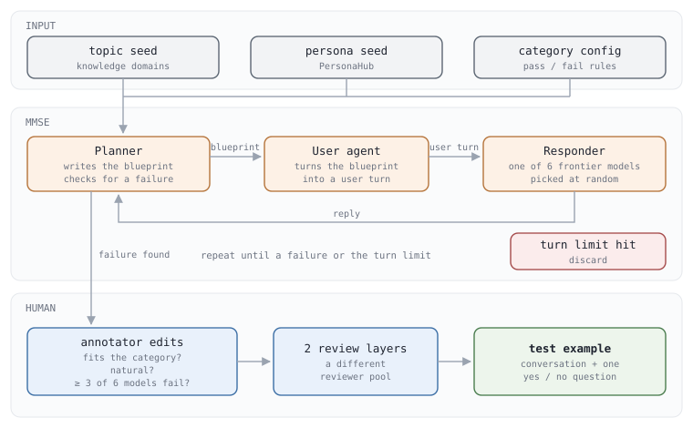

# Multi-turn Agent Eval 3 - MultiChallenge 는 대화를 고정하고 답 하나만 채점합니다

**이 논문은 사람과 여러 턴 대화하는 능력을, 최신 모델도 틀리는 문제로 자동
채점하려고 만든 것입니다.**

Scale AI 가 2025년 1월에 냈습니다. 논문은 기존 여러 턴 벤치마크에서는 최신
모델들이 거의 만점을 받는다고 지적합니다. 그래서 그 모델들이 실제로 틀리는 대화만
모았고, 결과는 모두 50% 아래였습니다.

## 1. 네 가지를 묻습니다

```
  범주                        문제    보는 것
  Instruction retention       69      첫 턴에 준 지시를 끝까지 지키나
  Inference memory            113     앞에서 흘린 사용자 정보를 알아서 챙기나
  Reliable versioned editing  41      여러 번 고친 글에서 맞는 버전을 이어 고치나
  Self-coherence              50      사용자가 의심하면 앞의 맞는 답을 버리나
```

마지막 줄은 아첨(sycophancy) 문제입니다. 사용자가 같은 걸 다시 묻거나 살짝
의심하면 모델이 자기가 앞에서 한 맞는 말을 버리고 사용자 편을 듭니다. 논문은 이게
대화를 어색하게 만들고 신뢰를 떨어뜨린다고 적었습니다.

## 2. 문제 하나가 이렇게 생겼습니다

공개된 파일 `benchmark_questions.jsonl` 의 한 줄이 문제 하나입니다. Inference
memory 문제 하나를 펼치면 이렇습니다.

```
  AXIS            INFERENCE_MEMORY
  CONVERSATION
    user        "... I prefer venues that are within a 5-minute walk from the
                 UN headquarters."
    assistant   "... Here are a few suggestions that are within a 5-minute walk:
                 ..."
    user        "I am meeting a German diplomat on Friday. I am looking for a
                 suitable place to have lunch with him, preferably an up-class
                 restaurant. ..."
  TARGET_QUESTION "Are the restaurants chosen within a 5-minute walk from the
                   UN headquarters?"
  PASS_CRITERIA   "YES"
```

대화는 **user 턴으로 끝납니다.** 모델은 그 마지막 턴에 답 하나만 씁니다. 마지막
턴은 "걸어서 5분" 을 다시 말하지 않습니다. 첫 턴을 기억해서 스스로 챙겨야 합니다.

```
  CONVERSATION      user · assistant 가 번갈아 나오는 대화. 평균 9.1턴 (3~19)
  TARGET_QUESTION   답만 보고 yes / no 로 답할 수 있는 질문. 사람이 썼다
  PASS_CRITERIA     통과하려면 나와야 하는 답. 273개 모두 "YES"
```

**읽는 건 여러 턴, 쓰는 건 한 턴입니다.** 1편의 "써 둔 대화" 입니다. 마지막 턴만 보면
아무 고급 식당이나 답해도 되는데, 첫 턴을 써야 맞으니 여러 턴 시험입니다. 그래서
모델이 앞에서 실수하고 바로잡는 능력은 볼 수 없지만, 모든 모델이 같은 기록에서
시작하니 같은 조건으로 비교할 수 있습니다.

## 3. 문제를 이렇게 만들었습니다



**이 그림은 시험 문제를 만드는 과정입니다.** 내 agent 를 잴 때는 돌리지 않고,
만들어진 파일만 씁니다. 채점하는 과정은 4절의 그림입니다.

LLM agent 셋이 대화를 지어냅니다. 논문은 이 장치를 MMSE 라고 부릅니다.

```
  Planner      주제 · 인물 · 범주 정의를 받아 대화의 설계도(blueprint)를 쓴다
               대화가 이어질 때마다 설계도를 고치고, 상대가 틀렸는지 판단한다
  User agent   설계도를 실제 사용자 말로 바꾼다. 상대가 틀리도록 유도한다
  Responder    답하는 쪽. 최신 모델 6개 중 하나를 문제마다 무작위로 뽑는다
```

Planner 가 실패를 찾으면 멈추고 저장하고, 턴 제한까지 못 찾으면 버립니다. 저장된
대화는 사람이 고칩니다. 범주에 맞는지, 자연스러운지, 그리고 **최신 모델 6개 중
3개 이상이 틀리는지**를 봅니다. 그다음 처음 고친 사람들과 겹치지 않는 검토자들이 두
단계로 더 검토합니다.

LLM 이 먼저 지어 두니 사람의 일이 줄었습니다. 문제 하나에 처음부터 쓰면 154.4분,
고쳐 쓰면 73.6분이 걸렸습니다. 고치기 전과 후의 문자열 유사도(Levenshtein 거리
기준)는 평균 74.5% 였고, 저자들은 나머지 25.5% 를 사람이 고친 몫으로 봤습니다.

## 4. 채점은 질문 하나로 합니다


**판정하는 모델은 대화를 보지 않습니다.** 모델의 답과 yes / no 질문만 받습니다.
저자 코드의 판정 프롬프트 원문 전체입니다.

```
  You are tasked with evaluating a model response to see if it meets a specific criteria.
  The criteria will always be YES/NO evaluation.
  The model response is as follows:
  <MODEL_RESPONSE>
  {}
  </MODEL_RESPONSE>
  The criteria that the model response must meet is as follows. Be VERY STRICT!:
  <CRITERIA>
  {}
  </CRITERIA>
  Print your reasoning followed by your verdict, either "YES" or "NO".
```

`{}` 두 자리에 차례로 모델의 답과 `TARGET_QUESTION` 이 들어갑니다(빈 줄은 줄였습니다).
판정은 `gpt-4o-2024-08-06` 이 온도 0 으로 하고, 판정이 `PASS_CRITERIA` 와 같으면 통과입니다.

**왜 대화를 안 보여주나.** 대화 전체와 범주의 성공 · 실패 기준을 주고 판정시키면 사람과
37.33% 맞았습니다. 질문 하나만 주면 93.95% 맞았습니다. 논문의 설명은 이렇습니다.
판정을 맡을 모델들 자신이 이 시험에서 50% 를 못 넘는데, 대화를 읽고 남의 답을 제대로
판정하리라 믿기 어렵다는 것입니다. 질문 하나로 줄이면 판정은 **답 안에 견과류가
있나, 식당이 5분 거리인가** 같은 단순한 확인이 됩니다.


전체 점수는 범주 넷의 점수를 **단순 평균**합니다. 41문제짜리 범주와 113문제짜리
범주가 같은 무게입니다.

## 5. 코드가 있습니다

논문이 직접 링크한 [ekwinox117/multi-challenge](https://github.com/ekwinox117/multi-challenge)
에 데이터 273개, 채점 코드, 논문에서 잰 모델 12개의 답이 들어 있습니다. 쓰는 방법입니다.

```
  답을 이미 갖고 있을 때    python main.py --responses-file 내답.jsonl --output-file 결과.txt
  모델에게 직접 물을 때     python main.py --model-provider openai --provider-args model=gpt-4o temp=0 ...
```

판정에 OpenAI API 키가 필요합니다. `--attempts 3` 처럼 여러 번 돌리면 **한 번이라도
통과하면 통과**로 칩니다. 1편의 pass^k 와 정반대 쪽(pass@k)입니다.

커밋 `5ccefcc` 그대로는 채점이 시작되지 않을 것으로 보입니다. `src/evaluator.py` 가
`max_tokens=4096` 을 넘기는데 `src/models/openai.py` 의 생성자가 이 인자를 받지
않습니다. 코드를 읽고 판단한 것이고, 돌려 보지는 않았습니다.

## 6. 결론

사람이 직접 채점한 결과입니다(Table 2). 범주 넷의 평균입니다.


논문이 내린 결론입니다.

```
  1  최신 모델이 모두 50% 아래다. 1위가 41.4%
  2  모델마다 잘하는 범주가 다르다. Claude 는 retention(58.6),
     o1-preview 는 memory(41.5) · editing(39.0) 이 가장 높다
  3  턴 수가 늘어도 점수에 뚜렷한 경향이 없다. 저자들은 길이보다 앞을 이어 붙이는
     추론이 어려운 것일 수 있다고 봤다
  4  질문 하나로 판정하는 방식은 사람과 93.95% 맞는다. 자동 채점을 믿을 수 있다
```

논문이 스스로 단 한계도 있습니다. 첫째, **문제를 고른 6개 모델에게 불리합니다.** 그
모델들이 틀린 문제만 남겼기 때문입니다. 그래도 나중에 잰 공개 모델들은 모두 Claude 3.5
Sonnet 과 o1-preview 보다 낮았습니다. 둘째, **yes / no 질문조차 판정하기 어려운 문제는
빼 두었습니다.** 판정이 가능해지면 공개하겠다고 적었습니다.

이후 모델은 더 올라갔습니다. 2편에서 본 대로 Kimi K2(2025년 7월)는 54.1 입니다.

## 7. 내 agent 를 평가하려면

```
  문제 273개를 하나씩
    1  CONVERSATION 을 대화 기록으로 넣는다. 마지막이 user 턴이다
    2  내 agent 가 답 하나를 쓴다
    3  {"QUESTION_ID": ..., "RESPONSE": ["답"]} 을 한 줄씩 모은다
  python main.py --responses-file 내답.jsonl --output-file 결과.txt 로 채점한다
```

넣기 전에 정할 것입니다.

- **대화 기록을 어떻게 넣나.** 이 시험은 앞 턴들을 **지금 대화의 기록**으로 줍니다.
  지난 세션을 기억에서 꺼내는 시험이 아닙니다. agent 에 장기 기억 장치가 있어도, 기록을
  그대로 컨텍스트에 넣는 게 시험의 뜻에 맞습니다.
- **앞 턴의 assistant 답은 내 것이 아닙니다.** 다른 모델(최신 6개 중 하나)이 쓴 답이
  들어 있습니다. 내 agent 의 말투와 달라도 그대로 둡니다.
- **한 번만 돌립니다.** `--attempts` 를 늘리면 한 번이라도 통과하면 통과라 점수가
  오릅니다. 논문 숫자와 비교하려면 1 로 둡니다.

내 데이터로 이런 시험을 만드는 법은 6편에서 제안합니다.

## 출처

- **Sirdeshmukh 외 2025** (Scale AI) · *MultiChallenge: A Realistic Multi-Turn
  Conversation Evaluation Benchmark Challenging to Frontier LLMs*.
  [`arXiv:2501.17399`](https://arxiv.org/abs/2501.17399) (2025년 1월).
- **표와 본문이 다른 곳이 있습니다.** 5.1절 본문은 Claude 3.5 Sonnet 을 38.3%,
  o1-preview 를 34.6, Gemini 를 19.1 로 적었는데, 바로 위 Table 2 와 초록은 41.42 ·
  37.23 · 19.96 입니다. v1(2025년 1월)과 v2(2025년 3월)가 같습니다. 차트는 표를 따랐습니다.
- **2 · 4 · 5 · 7절의 데이터와 채점은 저자 저장소에서 확인했습니다.**
  [ekwinox117/multi-challenge](https://github.com/ekwinox117/multi-challenge) 의
  `data/benchmark_questions.jsonl`, `src/evaluator.py`, `src/result_parser.py`,
  `main.py` 입니다. 2025년 2월 5일 커밋 `5ccefcc` 기준입니다.
- **Kimi K2 의 소개와 결이 다릅니다.** K2 보고서는 이 시험을 *"multi-turn dialogues
  with conflicting instructions"* 라고 한 줄로 소개했는데, 원 논문의 instruction
  retention 은 오히려 *"human users don't provide followup instructions that
  contradict the first-turn instructions"* 라고 적었습니다.
- **라이선스가 arXiv 기본이라 논문 그림을 싣지 않았습니다.** 3 · 4절의 그림은
  `scripts/gen_multichallenge_graphs.py`, 4 · 6절의 차트는 Table 4 와 Table 2 의
  숫자로 `scripts/gen_multiturn_charts.py` 가 그립니다.
