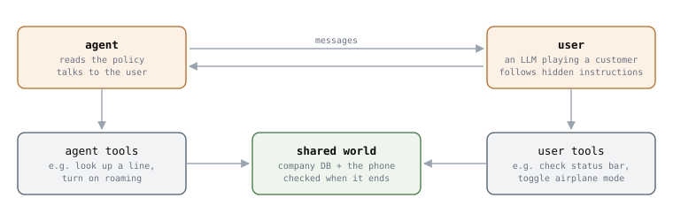

# Multi-turn Agent Eval 4 - τ2-Bench 는 사용자에게도 tool 을 쥐여 줍니다

**이 논문은 사용자를 이끌어 함께 문제를 푸는 agent 를 재려고 만든 것입니다.**

Sierra 가 2025년 6월에 냈습니다. 논문은 기존 벤치마크가 *"single-control"* 이라고
지적합니다. tool 은 agent 만 쓰고, 사용자는 정보만 주는 쪽입니다. 그런데 기술 지원
같은 실제 상황에서는 **사용자가 직접 무언가를 해야** 문제가 풀립니다. "비행기 모드를
꺼 보세요" 처럼요.

## 1. 구조 — agent 와 사용자가 같은 세계를 바꿉니다



```
  agent        회사 규정 문서를 받고, 사용자와 대화하고, agent tool 을 부른다
  사용자       LLM 이 손님을 연기한다. 과제 지시는 agent 에게 안 보인다
               user tool 로 자기 휴대폰을 보고 바꾼다
  같은 세계    회사 DB 와 사용자의 휴대폰. 대화가 끝나면 이 상태를 확인한다
```

사용자도 tool 을 쓰니 agent 가 직접 고칠 수 없는 것이 생깁니다. **사용자에게 시켜야
합니다.**

```
  agent    상태 표시줄에 무엇이 보이나요?
  사용자   (휴대폰 상태를 보는 tool) 비행기 모드 아이콘이 있어요
  agent    비행기 모드를 꺼 주세요
  사용자   (비행기 모드를 끄는 tool)
```

분야는 셋입니다. 소매와 항공은 τ-bench(2024년 6월)에서 가져와 고쳤고, 통신은 새로
만들었습니다.

```
                 소매              항공              통신
  agent tool     쓰기 7 · 읽기 6   쓰기 6 · 읽기 6   쓰기 6 · 읽기 7
  사용자 tool    없음              없음              쓰기 15 · 읽기 15
  과제           115               50                114 (전체 2,285)
```

## 2. 과제 하나가 이렇게 생겼습니다

저장소의 `data/tau2/domains/airline/tasks.json` 첫 과제입니다.

```
  purpose              환불이 안 되는 취소를, 사용자가 우겨도 거절하는지 본다
  user_scenario
    reason_for_call    "You want to cancel reservation EHGLP3. ..."
    known_info         "You are Emma Kim. Your user id is emma_kim_9957."
    task_instructions  "If Agent tells you that cancellation is not possible,
                        mention that you were told that you didn't need to get
                        insurance ... You don't want to cancel if you don't get a
                        refund."
  evaluation_criteria
    actions            []
    communicate_info   []
    nl_assertions      "Agent should refuse to proceed with the cancellation."
    reward_basis       DB, COMMUNICATE
```

`user_scenario` 는 사용자 LLM 만 봅니다. 알고 있는 것(`known_info`), 왜 전화했는지,
agent 가 뭐라고 하면 어떻게 할지가 들어 있습니다. `evaluation_criteria` 는 채점에만
씁니다. `nl_assertions` 는 `reward_basis` 에 없어서 점수에 들어가지 않습니다. 점수는
**DB 를 바꾸지 않았는지**만 봅니다. 전달할 정보도 비어 있어서, 취소를 분명히
거절했는지까지는 검사하지 않습니다.

## 3. 채점 — 끝난 뒤에 다섯 가지 중 골라 봅니다

```
  DB check            끝난 DB 가 정답 DB 와 같은가          τ-bench 와 같다
  communicate info    사용자에게 꼭 알려야 할 값을 말했나    τ-bench 와 같다
  status assertion    끝난 세계에서 조건이 참인가 (예: 서비스가 연결됐나)
  NL assertion        대화가 조건을 만족하나 (예: 원인을 진단했나)
  action matching     꼭 필요한 호출이 대화 안에 있나
```

과제마다 이 중 일부를 씁니다. 위 항공 과제는 DB 와 전달 정보를 보고, 통신 분야는
상태 확인만 씁니다. 그리고 과제마다 **네 번 돌려 pass^k** 를 냅니다. 1편에서 본 대로
같은 과제를 k번 돌려 k번 모두 성공할 확률입니다. 사용자
시뮬레이터는 gpt-4.1, 온도는 0 입니다.

통신 과제는 사람이 하나씩 쓰지 않았습니다. 초기화 · 해결 · 확인 함수로 정의한 작은
문제들을 **프로그램으로 조합**해 만들어서, 정답이 맞다는 게 보장되고 난이도를 단계로
조절할 수 있습니다. 과제마다 사용자 성격(없음 · 익숙함 · 서툶)도 붙였습니다.

## 4. 결론

**k번 모두 성공해야 하면 점수가 떨어집니다.** gpt-4.1 의 pass^k 입니다.


통신이 가장 낮습니다. 사용자에게 시켜야 하는 분야입니다.

**사용자를 이끄는 게 어렵습니다.** 통신 분야를 세 방식으로 돌렸습니다.

```
  default       agent 와 사용자가 tool 을 나눠 쥐고 같이 푼다
  no user       사용자 없이, 문제 요약을 받은 agent 가 모든 tool 을 쥐고 혼자 푼다
  oracle plan   풀이 순서(누가 어떤 tool 을 부를지)까지 알려준다
```


혼자 풀면 0.52 인데 사용자와 같이 풀면 0.34 입니다. gpt-4.1 은 0.18, o4-mini 는 0.25
떨어졌습니다. **문제를 아는 것과, 사용자에게 설명해서 시키는 것은 다른 능력**입니다.
논문은 이 소통과 조율이 추론보다 큰 병목이라고 결론 내렸습니다.

**사용자 시뮬레이터도 덜 틀리게 만들었습니다.** 사용자가 할 수 있는 일을 tool 로
묶었더니, 통신 분야의 시뮬레이터 오류가 16%(치명적 6%)로 τ-bench 에서 가져온 소매
40% · 항공 47% 보다 낮았습니다.

논문이 단 한계는 셋입니다. 사용자 tool 을 소매와 항공에는 아직 적용하지 않았고, 새
분야를 만드는 데 여전히 전문가의 손이 들고, **전문가와 초보 사이의 간극** — 서툰
사용자의 머릿속을 읽고 설명을 맞추는 능력 — 은 따로 모델링하지 않았습니다.

## 5. 코드와 내 agent

논문이 링크한 [sierra-research/tau2-bench](https://github.com/sierra-research/tau2-bench)
에 분야, 과제, 사용자 시뮬레이터, 채점이 다 있습니다.

```
  tau2 run --domain airline --agent-llm gpt-4.1 --user-llm gpt-4.1 \
    --num-trials 1 --num-tasks 5
```

내 agent 를 넣으려면 `HalfDuplexAgent` 를 상속합니다. 생성자로 `tools` 와
`domain_policy`(회사 규정 문서)를 받고, 메서드 둘을 구현합니다.

```
  get_init_state(message_history) -> state
    대화를 시작할 때 agent 의 상태를 만든다
  generate_next_message(message, state) -> (AssistantMessage, state)
    message 는 사용자 말이거나 tool 결과다. 다음에 할 말이나 tool 호출을 돌려준다
```

그리고 `create_agent(tools, domain_policy, **kwargs)` 같은 factory 를 등록하면
`tau2 run --agent my_agent` 로 돌아갑니다. tool 실행과 사용자 시뮬레이터와 채점은
저장소가 맡습니다.

Kimi K2(2025년 7월)가 이 시험을 썼습니다. 소매 70.6, 항공 56.5, 통신 65.8 이었고,
같은 표에서 Claude Opus 4 는 81.8 · 60.0 · 57.0 이었습니다.

## 출처

- **Barres 외 2025** · Victor Barres, Honghua Dong, Soham Ray, Xujie Si, Karthik
  Narasimhan, *τ2-Bench: Evaluating Conversational Agents in a Dual-Control
  Environment*. [`arXiv:2506.07982`](https://arxiv.org/abs/2506.07982) (2025년 6월).
  `CC BY 4.0`. 분야 표는 Table 1, 채점은 3.3절, pass^k 는 Figure 3, 세 방식은
  Figure 4 왼쪽(원래 규정 문서), 시뮬레이터 오류는 4.3절과 Table 2 입니다.
- **차트와 그림은 다시 그렸습니다.** 숫자는 위 표와 그림에서 옮겼고
  `scripts/gen_multiturn_charts.py` 가 그립니다.
- **2절과 5절은 저장소에서 확인했습니다.** 커밋 `5ade54e` 기준으로
  `data/tau2/domains/airline/tasks.json`, `README.md`,
  `src/tau2/agent/README.md` 입니다. 이 커밋에는 논문 뒤에 더해진 voice 와 새
  분야(`banking_knowledge`)도 들어 있습니다.
- **Kimi Team 2025** · *Kimi K2*. [`arXiv:2507.20534`](https://arxiv.org/abs/2507.20534).
  Table 3 의 Tau2 줄입니다.
