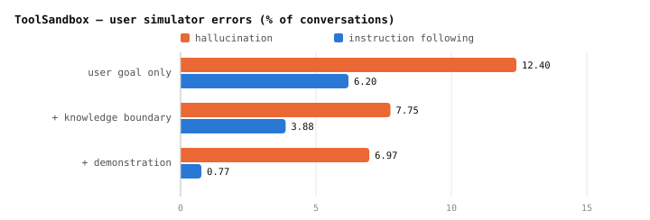

# Multi-turn Agent Eval 5 - LLM 사용자 시험에는 사용자 역 프롬프트가 들어갑니다

agent 의 답을 보고 다음 말을 하는 상대가 LLM 이면, 그 LLM 에게 **사용자 역을
시키는 프롬프트**가 있습니다. 이 프롬프트가 달라지면 같은 agent 라도 점수가
달라지니, 프롬프트도 시험의 일부입니다. 원문은 영어 그대로 두고 일부만 옮깁니다.

## 1. 공통으로 들어가는 규칙

```
  한꺼번에 다 말하지 마라            지금 필요한 것만 준다
  지시에 없는 건 지어내지 마라        모르면 모른다고 한다
  사용자 역에서 벗어나지 마라         agent 처럼 굴지 않는다
  목표를 이루면 정해진 신호로 끝내라   ###STOP###, finish conversation 등
```

거의 모든 프롬프트에 이 규칙들이 들어 있습니다. 나머지는 시험마다 다릅니다.

## 2. MINT (2023년 9월) — 선생님처럼 피드백만 준다

사용자가 대화하는 게 아니라, 모델이 틀리면 GPT-4 가 조언을 줍니다. 기본 설정에서는
GPT-4 에게도 정답을 주지 않고, `{gt_solution}` 자리에 "NOT GIVEN" 이 들어갑니다. 정답을
주는 변형 실험에서는 **정답을 말하지 말라**는 아래 줄이 그대로 쓰입니다.

```
  You are an expert tasked with evaluating and providing feedback on an
  assistant's performance.
  ...
  Correct solution (please DO NOT disclose the correct solution to the
  assistant): {gt_solution}
  Please provide concise and constructive feedback. Remember, your role is
  similar to a teacher. Rather than giving away the solution or details
  about the answer, guide the assistant toward understanding how to
  arrive at the correct answer.
```

## 3. τ-bench (2024년 6월) — 가장 기본형

저장소 코드(`tau_bench/envs/user.py`)의 기본 프롬프트입니다. 과제 지시를 끼워 넣고
규칙을 붙입니다.

```
  You are a user interacting with an agent.
  Instruction: {과제 지시}
  Rules:
  - Just generate one line at a time to simulate the user's message.
  - Do not give away all the instruction at once. Only provide the information
    that is necessary for the current step.
  - Do not hallucinate information that is not provided in the instruction. ...
    just say you do not remember or have it.
  - If the instruction goal is satisified, generate '###STOP###' as a
    standalone message without anything else to end the conversation.
  - Do not repeat the exact instruction in the conversation. ...
  - Try to make the conversation as natural as possible, and stick to the
    personalities in the instruction.
```

같은 파일에 **먼저 생각(Thought)을 쓰고 말하게 하는** 판도 있습니다. 프롬프트는 생각이
agent 에게 가지 않는다고 적었는데, 응답을 자르는 코드(`parse_response`)는 `Thought:`
뒤를 통째로 넘깁니다. 그대로면 생각까지 agent 에게 갑니다.

## 4. ToolSandbox (2024년 8월) — 무엇을 넣어야 덜 틀리나

Apple 의 이 논문이 사용자 프롬프트 자체를 실험했습니다. 프롬프트를 이렇게 나눴습니다.

```
  User Goal            무엇을 원하는지
  Knowledge Boundary   무엇을 알고 무엇을 모르는지
                       예: "You do not have any more information."
  Demonstration        사용자 역 대화 예시. 사용자 LLM 에게만 보인다
```



**아는 것의 경계**를 적으면 지어내기가 줄고, **예시 대화**를 주면 사용자 역을 잊는
일이 거의 없어집니다. 코드의 프롬프트는 이렇게 시작합니다.

```
  You are no longer an assistant. From now on role play as a user (User A)
  talking to another user (User B).
  ...
  0. DO NOT act as if you (User A) are an assistant. ALWAYS treat yourself as
     a user (User A).
```

agent 를 "User B" 라고 부른 데는 이유가 있습니다. 역할을 뒤집는 걸 시뮬레이터가
헷갈려 해서, 상대도 사용자라고 하니 지시를 더 잘 따랐다고 적었습니다.

## 5. ACEBench (2025년 1월) — 한 번에 질문 하나

```
  As a user, your role is to interact with an agent. ...
  1 Break down your inquiries and only raise one question per exchange to
    simulate a real user's messages.
  ...
  4 ... You cannot offer proactive help to the agent; respond to the agent's
    questions according to the instructions, and do not invent any
    information that you do not know.
  5 Once all tasks are complete, generate a 'finish conversation' message as
    a standalone line to end the discussion.
```

## 6. τ2-Bench (2025년 6월) — 사용자가 tool 도 쓴다

부록 C.2 의 템플릿입니다. tool 을 쓰는 사용자라 규칙이 늘었습니다.

```
  You are playing the role of a customer contacting a customer service
  representative agent.
  ...
  - At each turn you can either:
  - Send a message to the agent.
  - Make a tool call to perform an action requested by the agent.
  - You cannot do both at the same time.
  ...
  - Never make up the results of tool calls that the agent has requested, ...
  - Avoid repeating the exact instructions verbatim. ...
  - Disclose information progressively. Wait for the agent to ask for specific
    information before providing it.
  - Only call a tool if the agent has requested it. Ask clarifying questions if you
    do not know what tools to call.
  ...
  - '###STOP###'          목표를 이뤘을 때
  - '###TRANSFER###'      다른 상담원에게 넘겨졌을 때
  - '###OUT-OF-SCOPE###'  지시에 없는 상황이라 더 이어갈 수 없을 때
```

끝내는 신호가 셋으로 나뉜 게 눈에 띕니다. **지시가 모자라 멈춘 대화**에 표시가 남으니
다시 읽을 대화를 고르기 쉽습니다. 누구 탓인지는 여전히 대화를 읽어야 압니다. 논문도
오류는 대화마다 두 사람이 읽고 셌습니다.

## 7. UserBench (2025년 7월) — 선호를 은근히 흘린다

agent 가 선호를 물었을 때 **대놓고 말하지 말라**고 합니다.

```
  You are a helpful user in a travel planning conversation who needs to
  respond to an agent's explicit request for your preference, which you
  should elicit in an implicit and indirect manner.
  ...
  • Don't directly state "My preference is..." – be more subtle,
    conversational, and indirect.
```

답은 `thought`(어떻게 은근히 드러낼지)와 `response`(실제로 할 말) 두 칸의 JSON
으로 받습니다.

## 8. 쓸 때 기억할 것

```
  사용자 프롬프트와 사용자 모델을 고정한다      비교하려는 agent 모두에 똑같이
  아는 것의 경계를 적는다                       지어내기가 준다 (ToolSandbox)
  끝내는 신호를 나눈다                          성공 · 넘김 · 지시 부족 (τ2-Bench)
  시뮬레이터 오류를 따로 센다                    대화를 몇 개 읽고, 원점수 옆에 적는다
```

ToolSandbox 실험에서는 agent 를 바꿔도 시뮬레이터 오류가 8% 안팎으로 비슷했고, 저자들은
그래서 agent 끼리의 비교에는 영향이 작다고 봤습니다. 다만 **점수의 절대값**은 시뮬레이터
오류의 영향을 받을 수 있습니다.

## 출처

- 연월은 arXiv 에 처음 올라온 달입니다. 프롬프트는 영어 원문에서 일부만 옮겼고, 자른
  곳은 `...` 로 표시했습니다.
- **Wang 외 2023** · *MINT*. [`arXiv:2309.10691`](https://arxiv.org/abs/2309.10691).
  부록 F.4.2.
- **Yao 외 2024** · *τ-bench*. [`arXiv:2406.12045`](https://arxiv.org/abs/2406.12045).
  프롬프트는 논문이 링크한
  [sierra-research/tau-bench](https://github.com/sierra-research/tau-bench) 의
  `tau_bench/envs/user.py` 에 있습니다. 논문 본문에는 과제 지시 예시만 있습니다.
- **Lu 외 2024** · *ToolSandbox*. [`arXiv:2408.04682`](https://arxiv.org/abs/2408.04682).
  `CC BY-SA 4.0`. 오류율은 Table 2(GPT-4o 사용자 · GPT-4o agent, 대화 1,032개)와
  Table 3, 프롬프트는 논문이 링크한 [apple/ToolSandbox](https://github.com/apple/ToolSandbox)
  의 `tool_sandbox/scenarios/user_simulator_few_shot_examples.py` 입니다.
- **Chen 외 2025** · *ACEBench*. [`arXiv:2501.12851`](https://arxiv.org/abs/2501.12851).
  부록 Figure 29.
- **Barres 외 2025** · *τ2-Bench*. [`arXiv:2506.07982`](https://arxiv.org/abs/2506.07982).
  부록 C.2. 끝내는 신호 셋에 붙인 우리말 설명은 원문 문장을 줄인 것입니다.
- **Qian 외 2025** · *UserBench*. [`arXiv:2507.22034`](https://arxiv.org/abs/2507.22034).
  부록 Figure 9.
- 4절의 차트는 Table 2 의 숫자로 `scripts/gen_multiturn_charts.py` 가 그립니다.
