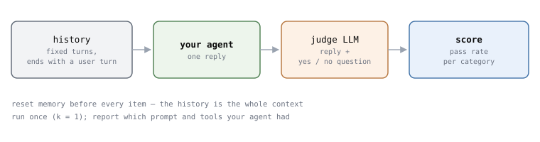
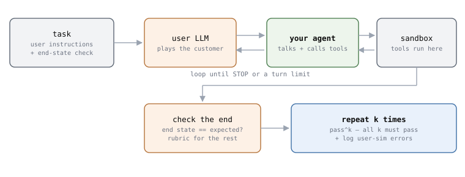

# Multi-turn Agent Eval 6 - 내 agent 는 써 둔 대화와 LLM 사용자로 두 번 잽니다

써 둔 대화로는 agent 가 대화를 놓치지 않는지 보고, LLM 사용자로는 일을 끝내는지
봅니다.

아래는 앞의 논문들 — τ-bench(2024년 6월), ToolSandbox(2024년 8월),
MultiChallenge(2025년 1월), τ2-Bench(2025년 6월) — 에서 방법을 골라 조합한
**제안**입니다. 어느 논문도 이 순서를 그대로 권하지는 않았습니다. 단계 옆의 이름이
그 방법을 가져온 논문입니다.

## 1. 써 둔 대화 — 대화를 놓치지 않는가



```
  1  문제를 만든다      내 서비스의 실제 대화에서, 앞에서 나온 정보나 지시가
                        뒤에서 필요해지는 자리를 찾아 그 user 턴에서 자른다
  2  질문을 붙인다      답만 보고 yes / no 로 판정할 수 있는 질문 하나        MultiChallenge
  3  답을 받는다        agent 의 기억을 비우고, 기록을 넣고, 답 하나를 받는다
  4  판정한다           판정 LLM 에게 답과 질문만 준다. 대화는 주지 않는다    MultiChallenge
  5  센다               범주별 통과율. 한 번만 돌린다
```

1번에서 찾을 자리는 MultiChallenge 의 네 범주를 체크리스트로 쓰면 됩니다.

```
  첫 턴의 지시를 끝까지 지키나        "앞으로 답은 세 줄로"
  흘린 정보를 알아서 챙기나           "걸어서 5분 안이면 좋겠어요"
  여러 번 고친 글에서 맞는 버전을 고치나
  사용자가 의심해도 맞는 답을 지키나
```

2번이 가장 중요합니다. **"좋은 답인가" 가 아니라 "답에 견과류가 있나" 처럼 묻습니다.**
MultiChallenge 는 대화를 통째로 주고 판정시키면 사람과 37% 맞았고, 질문 하나로
줄이자 94% 맞았습니다.

**판정 LLM 을 믿기 전에 한 번 맞춰 봅니다.** 문제 50개쯤을 사람이 직접 채점하고, 판정
LLM 과 몇 % 맞는지 봅니다. MultiChallenge 도 사람 판정과 맞춰 본 뒤에 자동 채점을
썼습니다.

**공개 시험으로 먼저 돌려 볼 수도 있습니다.** MultiChallenge 273문제와 채점 코드가
공개돼 있습니다. 3편에서 넣는 법을 적었습니다.

## 2. LLM 사용자 — 일을 끝내는가



```
  1  과제를 쓴다        사용자 지시 + 끝났을 때 맞아야 할 상태                τ2-Bench 형식
  2  sandbox 를 만든다  agent 의 tool 이 진짜 대신 가짜 DB 를 바꾸게 한다     τ-bench
  3  사용자 LLM 을 둔다 5편의 규칙 + 아는 것의 경계 + 대화 예시               ToolSandbox
  4  대화를 돌린다      사용자가 끝 신호를 내거나 턴 제한에 닿을 때까지
  5  채점한다           끝 상태가 정답과 같은가. 상태로 안 보이는 것만
                        yes / no 질문으로                                     τ2-Bench
  6  k번 돌린다         pass^1 과 pass^k 를 같이 적는다                       τ-bench
  7  시뮬레이터를 센다  실패한 대화 몇 개를 읽고, 사용자 탓인 실패를 표시     τ2-Bench
```

1번의 과제는 τ2-Bench 의 과제 형식을 그대로 빌리면 됩니다.

```
  user_scenario         사용자 LLM 만 본다
    reason_for_call       왜 연락했나
    known_info            사용자가 아는 것 (이름, 예약 번호)
    task_instructions     agent 가 이렇게 나오면 이렇게 한다
  evaluation_criteria   채점에만 쓴다
    끝 상태 조건          DB 가 이렇게 바뀌어야 한다
    꼭 전할 정보          사용자에게 이 값을 말해야 한다
```

**6번에서 k 는 4 정도면 됩니다.** τ2-Bench 도 과제마다 네 번 돌렸습니다. pass^1 만
보면 운 좋게 한 번 성공한 걸 잡아내지 못합니다. 고객을 상대하는 agent 라면 pass^4
가 실제에 더 가깝습니다.

**한 번 더 나눠 봅니다.** τ2-Bench 처럼 사용자 없이 agent 혼자 모든 tool 을 쥐고
풀게 해서 점수를 비교합니다. 혼자서도 못 풀면 **추론과 tool 사용**을, 혼자서는 푸는데
사용자와 같이 하면 못 풀면 **설명하고 이끄는 쪽**을 먼저 의심합니다. 원인은 실패한
대화를 읽어서 확인합니다.

**공개 시험으로 먼저 돌려 볼 수도 있습니다.** τ2-Bench 저장소는 내 agent 를
`HalfDuplexAgent` 로 붙이면 사용자 시뮬레이터와 채점을 다 맡아 줍니다. 4편에 적었습니다.

## 3. 결과와 함께 적을 것

같은 agent 라도 이것들이 바뀌면 점수가 바뀝니다.

```
  agent         모델, system prompt, 켠 tool, 기억 장치를 켰는지
  사용자 쪽     사용자 모델과 사용자 프롬프트 (써 둔 대화면 대화 기록의 출처)
  판정 쪽       판정 모델, 판정 프롬프트, 사람과 맞춰 본 일치율
  돌린 방식     k, 온도, 시뮬레이터 탓으로 보이는 실패의 수 (원점수와 따로)
```

## 4. 어느 쪽부터 할까

```
  대화로 요구를 알아내는 비서     써 둔 대화부터. 놓치는 정보가 보인다
  tool 로 일을 처리하는 agent    LLM 사용자부터. 끝 상태로 바로 채점된다
```

어느 쪽이든 **한 턴 점수로 여러 턴 능력을 짐작하지 않습니다.** MINT(2023년 9월)는
한 턴에서 잘하는 모델이 여러 턴에서도 잘하는 건 아니라고 적었고, Lost in
Conversation(2025년 5월)은 같은 과제를 여러 턴으로 쪼개 주자 최신 모델들이 평균 39%
떨어졌다고 적었습니다.

## 출처

- 이 편은 제안입니다. 각 단계의 근거가 된 논문은 단계 옆에 적었고, 숫자는 앞 편들에서
  원문을 확인한 것입니다.
- **MultiChallenge** · [`arXiv:2501.17399`](https://arxiv.org/abs/2501.17399).
  네 범주, yes / no 질문, 37% · 94%.
- **τ-bench** · [`arXiv:2406.12045`](https://arxiv.org/abs/2406.12045). 가짜 DB 와 끝 상태,
  pass^k.
- **ToolSandbox** · [`arXiv:2408.04682`](https://arxiv.org/abs/2408.04682). 아는 것의
  경계와 대화 예시.
- **τ2-Bench** · [`arXiv:2506.07982`](https://arxiv.org/abs/2506.07982). 과제 형식(저장소의
  `tasks.json`), 네 번 반복, 사용자 없이 푸는 방식, 시뮬레이터 오류 세기.
- **MINT** · [`arXiv:2309.10691`](https://arxiv.org/abs/2309.10691).
- **Lost in Conversation** · [`arXiv:2505.06120`](https://arxiv.org/abs/2505.06120).
- 그림 두 장은 `scripts/gen_multiturn_charts.py` 가 그립니다.
