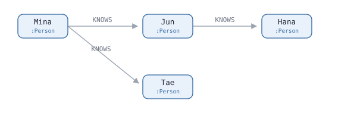

# Cypher 1 - 그림을 그대로 적습니다

Neo4j 에 물어볼 때 쓰는 말이 **Cypher** 입니다. 표를 다루는 SQL 과 달리
**node 와 edge 로 된 그림**을 다룹니다.

그래서 쿼리가 그림처럼 생겼습니다. 기호 셋이 전부입니다.

```
  ( )       node
  -[ ]->    edge
  { }       속성
```

이 편에서 이 셋을 하나씩 보고, [2편](./02-paths.md) 에서 그걸로 긴 길을
찾습니다.

## 1. node — `( )`

사람 하나, 가게 하나가 node 입니다. 괄호 안에 둘을 적을 수 있습니다.

```
  ( )            아무 node 나
  (:Person)      Person 종류인 node
  (f)            node 하나. 뒤에서 f 라고 부르겠다
  (f:Person)     Person 종류인 node. 뒤에서 f 라고 부르겠다
```

`:Person` 을 **라벨**이라고 하는데, 그냥 **종류**라고 보면 됩니다. 앞의 `f` 는
**이름표**입니다. 결과로 꺼내거나 뒤에서 또 쓸 때만 붙이고, 안 쓸 거면
비워둡니다.

## 2. edge — `-[ ]->`

node 둘을 잇습니다. **화살표 방향이 있습니다.**

```
  -[:KNOWS]->    KNOWS 종류의 edge 를 따라 앞으로
  <-[:KNOWS]-    거꾸로
  -[:KNOWS]-     방향은 상관없다. 어느 쪽이든 따라간다
  -[r:KNOWS]->   edge 에도 이름표를 붙일 수 있다
```

**방향 무시가 중요합니다.** `(제자)-[:TRAINED_UNDER]->(스승)` 처럼 한 방향으로만
저장해 둬도, 찾을 때 `-` 로 적으면 스승 쪽에서 제자 쪽으로도 갈 수 있습니다.

## 3. 속성 — `{ }`

node 에도 edge 에도 값이 붙습니다.

```
  (p:Person {name: 'Mina'})      name 이 'Mina' 인 Person
  -[:KNOWS {since: 2019}]->      since 가 2019 인 KNOWS edge
```

## 4. 찾아서 꺼내기 — `MATCH` 와 `RETURN`

사람 넷이 이렇게 이어져 있다고 합시다.



`Mina` 의 친구를 찾습니다.

```
MATCH (me:Person {name: 'Mina'})-[:KNOWS]->(f:Person)
RETURN f.name
```

```
f.name
"Jun"
"Tae"
```

```
  MATCH          이런 모양을 찾아라.  SQL 의 SELECT ... WHERE 자리
  RETURN         찾은 것 중 뭘 꺼낼지
  f.name         f 라고 이름 붙인 node 의 name 속성
```

**찾을 모양을 그림으로 적는 게 다른 점입니다.** 위 한 줄은 그림에서 `Mina` 에서
나가는 화살표를 눈으로 따라가는 것과 같습니다.

## 5. 두 단계

화살표를 한 번 더 이으면 됩니다.

```
MATCH (me:Person {name: 'Mina'})-[:KNOWS]->(:Person)-[:KNOWS]->(fof:Person)
RETURN fof.name
```

```
fof.name
"Hana"
```

가운데 `(:Person)` 에 이름표가 없습니다. **거쳐 가기만 하고 결과로 안 꺼내니까
비워둔 것**입니다.

`Tae` 는 결과에 없습니다. `Tae` 에서 나가는 `KNOWS` edge 가 없어서 그림이 거기서
끊깁니다.

## 6. 이름 바꾸고, 줄 세우고, 자르기

```
MATCH (me:Person {name: 'Mina'})-[:KNOWS]->(f:Person)
RETURN f.name AS friend
ORDER BY friend
LIMIT 2
```

```
friend
"Jun"
"Tae"
```

```
  AS friend      결과 칸 이름을 friend 로 바꾼다
  ORDER BY       줄 세운다
  LIMIT          위에서 몇 개만
```

`ORDER BY` 와 `LIMIT` 과 `AS` 는 SQL 과 똑같습니다. **`ORDER BY` 를 안 쓰면
순서는 보장되지 않습니다.** 앞 절들의 결과도 순서가 달리 나올 수 있습니다.

## 7. `MATCH` 는 여러 개 쓸 수 있습니다

```
MATCH (me:Person {name: 'Mina'})-[:KNOWS]->(f:Person)
MATCH (f)-[:LIVES_IN]->(c:City)
RETURN f.name, c.name
```

**앞에서 붙인 이름표는 쿼리 끝까지 살아 있습니다.** 첫 줄의 `f` 를 둘째 줄에서
그대로 씁니다.

다만 `MATCH` 가 늘면 **행 수가 바뀝니다.** 앞 행 하나마다 뒤 모양이 맞는
만큼 행이 생깁니다 — 하나도 안 맞으면 **그 행은 사라지고**, 셋이 맞으면 세
행이 됩니다.

위 쿼리는 둘째 `MATCH` 가 `f` 로 앞과 이어져 있어서 그렇습니다. **안 이어진
모양을 쓰면 다릅니다.**

```
MATCH (f:Person)
MATCH (c:City)
```

이러면 사람 3명과 도시 4곳이 **모든 짝으로 12행**이 됩니다. 많이 이을 때는
중간에 `WITH ... LIMIT` 이나 `DISTINCT` 로 줄입니다. `WITH f, c` 를 쓰면 **그
뒤로는 `f` 와 `c` 만 남습니다.**

## 8. 값은 밖에서 넣습니다

```
MATCH (me:Person {id: $userId})-[:KNOWS]->(f:Person)
RETURN f.name
```

`$userId` 는 **쿼리를 부를 때 넣는 값**입니다. 이름을 쿼리에 박아 넣지 않고
비워두는 자리입니다.

## 9. 목록 다루기와 `|`

Cypher 는 목록을 자주 돌려줍니다. 목록을 한 번에 바꾸는 문법이 있습니다.

```
  [x IN 목록 | 바꿀 식]
```

파이썬의 `[바꿀 식 for x in 목록]` 과 **앞뒤만 뒤집힌 모양**입니다. 실제로
돌려보면 이렇습니다.

```
RETURN [n IN [1, 2, 3] | n * 10] AS tenfold
```

```
tenfold
[10, 20, 30]
```

`n` 은 **목록에서 하나씩 꺼낸 것**이고, `|` 뒤가 **그걸 어떻게 바꿀지**입니다.

### `|` 는 뜻이 둘입니다

같은 기호가 다른 자리에서 다른 일을 합니다. **헷갈리기 쉬운 자리라 미리
갈라둡니다.**

```
  [x IN 목록 | 식]      목록 안에서는  "각각 이렇게 바꿔라"
  -[:A|B]->             edge 안에서는  "A 또는 B"
```

두 번째는 `KNOWS` 든 `WORKS_WITH` 든 아무거나 따라가라는 뜻입니다.

```
MATCH (me:Person {name: 'Mina'})-[:KNOWS|WORKS_WITH]->(f:Person)
RETURN f.name
```

`KNOWS` 로 이어진 사람도, `WORKS_WITH` 로 이어진 사람도 다 나옵니다.

### 그리고 `*` 를 붙이면

2편에서 이런 모양을 만납니다. 조각으로 나눠 보면 새로울 게 없습니다.

```
  [:A|B|C*1..3]

  [: ... ]        edge 자리
  A|B|C           A 또는 B 또는 C
  *1..3           지나는 edge 가 1개에서 3개까지
```

**`*1..3` 의 숫자는 지나는 edge 의 개수입니다.** node 개수가 아닙니다. edge 를
두 개 지나면 node 는 셋을 밟습니다.

```
  (X) --A--> (Y)                edge 1개.  바로 옆
  (X) --A--> (Y) --C--> (Z)     edge 2개.  한 다리 건너
```

그래서 이 숫자를 **거리**라고 보면 됩니다. `*1..3` 은 *"거리 1에서 3 사이에
있는 것"* 입니다.

**그리고 `*` 는 edge 종류 전체에 걸립니다.** 세 종류를 섞어가며 가도 됩니다 —
위 둘째 줄처럼 `A` 로 한 번, `C` 로 한 번 가는 길도 거리 2로 걸립니다.

`//` 로 시작하는 줄은 주석입니다.

## 다음 편

두 단계면 `-[:KNOWS]->` 를 두 번 쓰면 됩니다. 그런데 **몇 단계인지 모르면**
어떻게 할까요. 한 단계일 수도 세 단계일 수도 있다면요.

[2편](./02-paths.md) 이 거기서 시작합니다.
