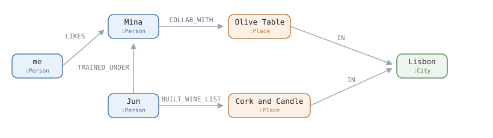

# Cypher 2 - 몇 단계 건너야 하는지 몰라도 됩니다

[1편](./01-basics.md) 에서 `-[:KNOWS]->` 를 두 번 이어 친구의 친구를
찾았습니다. 그런데 **몇 단계인지 모를 때**가 더 많습니다.

여기서는 그런 길을 한 줄로 적습니다.

## 1. 이런 데이터가 있다고 합시다

사람과 식당과 도시가 edge 로 이어져 있습니다.



`me` 는 `Mina` 를 좋아하고, `Mina` 는 `Olive Table` 과 협업했습니다. 그리고
`Jun` 은 `Mina` 밑에서 배웠고 `Cork and Candle` 의 와인 목록을 짰습니다.

**내가 좋아하는 사람과 이어진 리스본 식당**을 찾아보겠습니다. 한 단계일 수도
있고 세 단계일 수도 있습니다.

## 2. 쿼리 한 개

```
MATCH (me:Person {id: $userId})-[:LIKES]->(s:Person)
MATCH path = (s)-[:TRAINED_UNDER|COLLAB_WITH|BUILT_WINE_LIST*1..3]-(p:Place)
      -[:IN]->(:City {name: 'Lisbon'})
RETURN p.name,
       [r IN relationships(path) | type(r)] AS why,
       length(path) AS hops
ORDER BY hops
LIMIT 3
```

1편에 없던 게 넷뿐입니다.

```
  path =                찾은 길 전체에 이름을 붙인다
  [:A|B|C]              A 또는 B 또는 C edge
  *1..3                 지나는 edge 가 1개에서 3개까지 — 거리 1~3
  relationships(path)   길에 있는 edge 목록
```

나머지는 1편에서 본 것입니다 — `$userId`, `MATCH` 두 개, 이름표 없는 node,
`[x IN 목록 | ...]`, `AS`, `ORDER BY`, `LIMIT`.

## 3. 한 줄씩

### 첫 번째 MATCH

```
  (me:Person {id: $userId})    id 가 $userId 인 Person 을 me 라고 부른다
  -[:LIKES]->(s:Person)        me 가 LIKES 한 사람을 s 라고 부른다
```

그림에서 `s` 는 `Mina` 입니다.

### 두 번째 MATCH

여기가 이 편의 핵심입니다.

```
  *1..3                  거리가 1~3 사이면 된다. 몇인지 몰라도 된다
  끝이 -> 가 아니라 -    방향을 무시한다
  [:A|B|C]               세 종류 중 아무 edge 나
  (p:Place)              도착은 식당. 이름표는 p
  -[:IN]->(:City {...})  리스본에 있어야 한다
```

**`*1..3` 이 없으면 1단계용·2단계용·3단계용 쿼리를 따로 써야 합니다.** 그리고
1편에서 본 대로 **세 종류를 섞어서 건너도 됩니다** — 아래 길 B 가 그렇습니다.

그리고 끝이 `-` 라서 **거꾸로도 따라갑니다.** `Jun` 이 `Mina` 밑에서 배웠다는
edge 는 `Jun → Mina` 방향인데, `Mina` 에서 출발해 거슬러 `Jun` 으로 갈 수
있습니다.

도시는 결과로 안 꺼내니까 `(:City ...)` 에 이름표가 없습니다. 1편에서 본 그
자리입니다.

찾아지는 길이 둘입니다.

```
  A   Mina --COLLAB_WITH--> Olive Table --IN--> Lisbon            edge 2개
  B   Mina <--TRAINED_UNDER-- Jun
           --BUILT_WINE_LIST--> Cork and Candle --IN--> Lisbon    edge 3개
```

### RETURN

```
  p.name                   식당 이름
  relationships(path)      길에 있는 edge 목록
  [r IN 목록 | type(r)]    edge 마다 종류 이름만 꺼낸다
  length(path)             길 전체의 edge 개수. 곧 거리
```

## 4. 결과

```
p.name              why                                        hops
"Olive Table"       ["COLLAB_WITH", "IN"]                      2
"Cork and Candle"   ["TRAINED_UNDER", "BUILT_WINE_LIST", "IN"] 3
```

`hops` 가 `*1..3` 의 범위를 넘는 것처럼 보이는데 맞습니다. **`*1..3` 은
가운데 토막에만 걸리고, `length(path)` 는 마지막 `-[:IN]->` 까지 센
것**입니다. 길 B 는 가운데가 2개, `IN` 이 1개라 3입니다.

**`why` 가 쓸모 있습니다.** 식당 이름만 돌려주면 "왜 이걸 추천했지" 를 설명할
수 없는데, edge 종류가 같이 나오니 *"Olive Table 은 네가 좋아하는 Mina 랑
콜라보했어"* 라고 말할 수 있습니다.

## 5. SQL 로 쓰면

`*1..3` 한 줄이 **1단계·2단계·3단계 `JOIN` 을 각각 쓰고 `UNION` 으로 합치는**
일이 됩니다. 아니면 `WITH RECURSIVE` 를 꺼내야 합니다. 거기에 edge 종류 셋과
방향 무시까지 넣으면 더 길어집니다.

## 자주 묻는 것

**`*1..3` 의 숫자를 키우면 느려집니다.** 건너갈 수 있는 길이 단계마다 불어나서
그렇습니다. 쓸 만한 범위를 적어두는 게 낫습니다.
